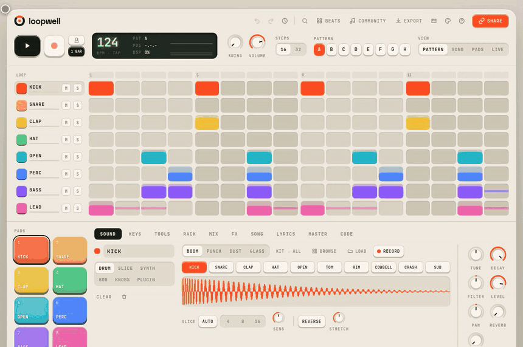
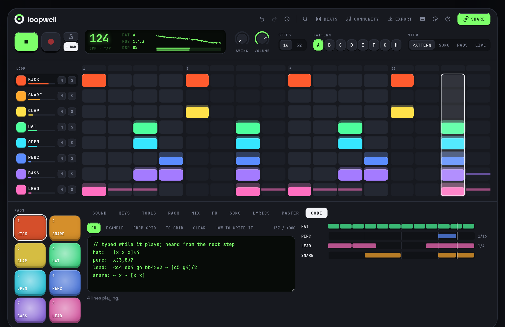
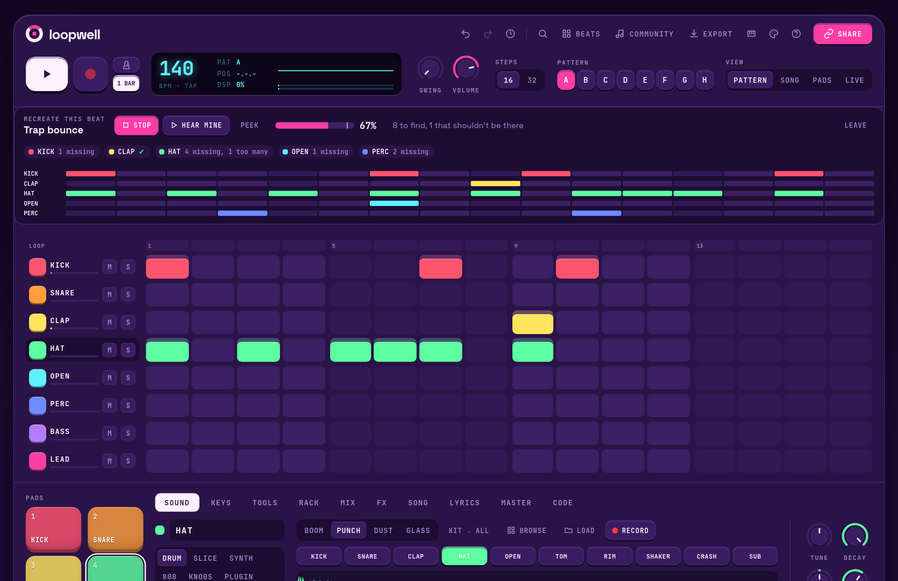
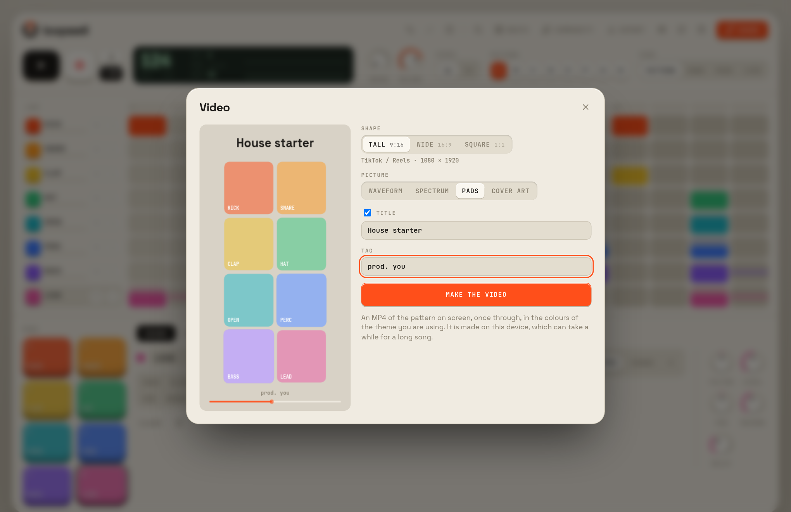
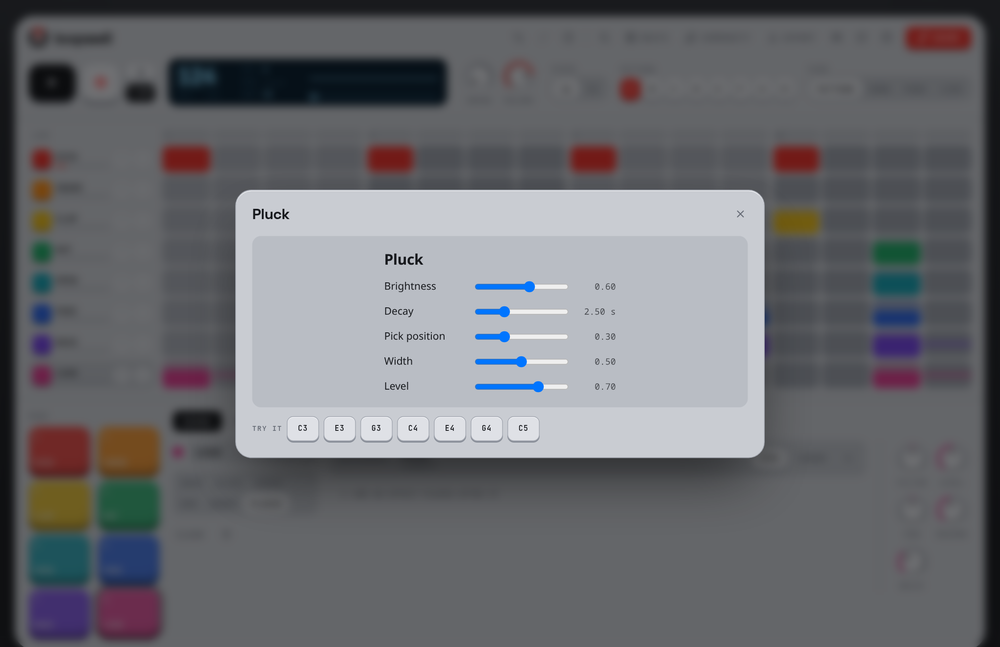
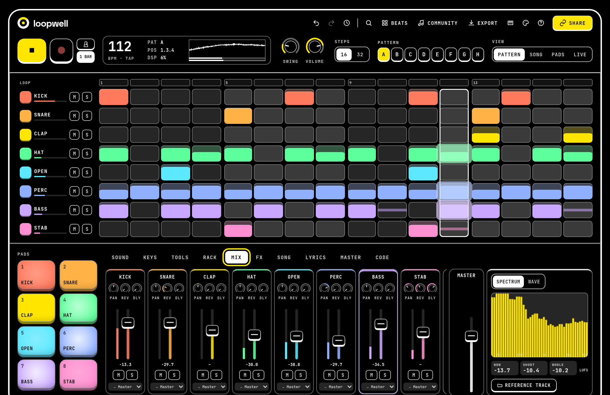

<div align="center">

<picture>
  <source media="(prefers-color-scheme: dark)" srcset="docs/banner-dark.svg">
  
</picture>

### A tactile beat maker that lives in your browser.

Make a beat in seconds, arrange it into a song, mix and master it, share it with a link.<br>No account, no install, nothing uploaded.

[](https://github.com/aubergine-ux/loopwell/actions/workflows/ci.yml)
[](package.json)
[](LICENSE)
[](https://github.com/aubergine-ux/loopwell/search?l=typescript)
[](#-install-it)
[](CHANGELOG.md)

**[▶ Open Loopwell](https://aubergine-ux.github.io/loopwell/)**

<br>



</div>

<br>

## 🎧 Hear it first

Each of these is a complete song packed into a URL. Click one and it plays.

| Beat | Style | Link |
| :-- | :-- | :-- |
| **Night Drive** | Four-on-the-floor house, 122 bpm | [▶ Play it](https://aubergine-ux.github.io/loopwell/#b=jVDBSsNAEJ3dbNPFYkmlhxxa20APQYogCJoYwqZJQGmIoSkeevIwogUPIuJBkHj06vf0J_wE_yTOBlEvgsO-YWfe7nvDcDZYQPcNl8HK8Fdq13X7nXx9ffMwTu7Xj1f8WYKYn8VzsKtbpQBkq8yjRcrsCnVpiTiLCt5U-2Abp9HSsKtQU2NxXqS5sC9munJFkS7itl0FSgVwIGZRWcL0MIS9_o7TSHkiS6OEhRMfpl3XyzJ1nBuvvN3rAbAnRAQKy6K02VAHff_7JAl1X0iD-X6LcwdNwhZhm02wy0doAvPQYAERCiVLscMUEQH-iH_o34j_MhiSzpAMRmQwIp3Bb4PoyyAmQjVDN_H-p64ODtJBKfWkpleAGRBUIc0jwgkhLIRDz1o17RVqNqYESt8uLaj5nR4a4BM) |
| **Dust Loop** | Swung boom-bap, 86 bpm | [▶ Play it](https://aubergine-ux.github.io/loopwell/#b=bY9BS8MwGIa_plntBkrxVDyUbpZaEWV6ciGUxpoy0zHL6g72nPsG6mUgZX_Bv-XZ3zO_rit48AsPLy9f4EmIcXbDToaaVxUJqsS756P-48fbuz9brdbk0waaP6W579Y6SQDsXjkXCzncVw8cms5EMXLrrFm65lS8nB-KT58LOQ_cmjctooVcpBdurSJst_RBlCXhAw945oXr5saE5vK1JMwOrCyKY5XcZZ75bZhbCmBstHZOm2Qbx8FkbPmDoVl7GODYZL-gYIb6yAj1gFzqYxJoG6xYgSUQiUyVbTEkRgQi1dZqDdr5ahWscyz_OADf2Dl6naNvXB081_95JghHEiRVFH8AZAcwhp0xRgXOLw) |
| **Glass Hours** | Half-time with a sliding sub, 140 bpm | [▶ Play it](https://aubergine-ux.github.io/loopwell/#b=LYpNS8NAEIZnsmtY_CJgkUViqOAhB5G2FtTgYZMY29AQl7a59CAtzMGDKBjsIQj7K_0p3t0tzvAOPPM-HoYERxuieMXUSkVx3DuYvG3atj_9-PpsvW8BfFbms4E0r0oBiL1Fnc6LoTTkMOB5lerRjsYg2TRd3kiTuKrPn3VRj6W5cxRzXczzW2nUi9JPQ7ZoMrYGAP1-FW2dcM-zoqo83buG0f5DVg_Ucs22mCq8xI7cWBsAAbHrmt-fBndPosSuu_-KAgEiwCRJfPAj8m2OvQsKRERnLKRzGwFeSQwL8llGh-yRAssnWNEpKynkE_oD) |
| **Punch Card** | Electro-funk with an acid bass, 112 bpm | [▶ Play it](https://aubergine-ux.github.io/loopwell/#b=lY7PSsNAEIdnN1uMUUqsRQNCKbWUhTZYiwcNIrsJaWtbYmj21JN_5uDJg-ClIHkFwVfwgXyBPkudLSpe3d2PmR-7zH6cHY0PqjGeXy6cs4VqSFn38penh8dmcveM_NUFMb1Opn5QolIAbqXI9Dzd28QW-CKZ6bwWlDN7GThjbfaD8sqGprjJ06welJFNUuTpPDkMyt49pVMR66KATmag5VXlrX1xIQqjYxg2BiAbbTXsqYFx3rmj2wBsiYi-b5slvFGJotWKCmL0e4QAgPXaXlL-u7eBSeSEw7pYobrFOuhyiTvsGHepr1LvCqaMYAkxIibG44pIiBExMfrj2wP9z40IIlijf5qEZBKSSZ9MQjLpkklIJpJMumRy8mOSEmNiRr_HRLqx8HhmRI3mc5rfhzXrkwOtLw) |

<br>

## 🆕 New in 3.0

<table>
  <tr>
    <td width="50%"></td>
    <td width="50%"></td>
  </tr>
  <tr>
    <td align="center"><b>Live coding</b>, in time with the grid</td>
    <td align="center"><b>Recreate this beat</b>, by ear</td>
  </tr>
  <tr>
    <td></td>
    <td></td>
  </tr>
  <tr>
    <td align="center"><b>Video export</b> for TikTok, Reels and YouTube</td>
    <td align="center"><b>Plugins</b>, yours or the community's</td>
  </tr>
</table>

Also new: stem separation, vocal tools, a mastering chain, MP3 and OGG export, DAW project export, an embeddable player, a launchpad, an 808 and a drum synth, step chance and rolls, grooves, chords, a command palette, a project browser, genre templates and a high-contrast theme. The full list is in the **[changelog](CHANGELOG.md)**.

<br>

## ✨ Features

**Make**

<table>
  <tr>
    <td align="center" width="56">🥁</td>
    <td width="170"><b>Step sequencer</b></td>
    <td>16 or 32 steps, up to 8 tracks, per-step velocity, swing, eight patterns. Steps can roll, play by chance, or only on certain repeats</td>
  </tr>
  <tr>
    <td align="center" width="56">🎲</td>
    <td width="170"><b>Pattern tools</b></td>
    <td>Euclidean rhythms, groove templates, chords and an arpeggiator, and dice that reroll a pattern or a sound while leaving locked tracks alone</td>
  </tr>
  <tr>
    <td align="center" width="56">🎼</td>
    <td width="170"><b>Piano roll</b></td>
    <td>Draw bass lines and melodies. Scale lock removes every out-of-key row, so wrong notes are hard to play</td>
  </tr>
  <tr>
    <td align="center" width="56">⌨️</td>
    <td width="170"><b>Live coding</b></td>
    <td>A Code tab that plays TidalCycles-style mini-notation in time with the grid, edited while it plays</td>
  </tr>
  <tr>
    <td align="center" width="56">🎬</td>
    <td width="170"><b>Song timeline</b></td>
    <td>Place patterns as clips on each track. Draw automation for any knob, change tempo and time signature, drop markers, pin lyrics to the bar they are sung on</td>
  </tr>
  <tr>
    <td align="center" width="56">🎤</td>
    <td width="170"><b>Ideas to notes</b></td>
    <td>Hum a melody, tap a rhythm, open a MIDI file, or drop in a loop and have it fitted to the song's tempo</td>
  </tr>
</table>

**Sound**

<table>
  <tr>
    <td align="center" width="56">✂️</td>
    <td width="170"><b>Sampler</b></td>
    <td>Four built-in kits (40 CC0 sounds) or your own audio. Chop a sample at its hits, reverse it, stretch it. A browser with previews, detected tempo and key, favourites and tags</td>
  </tr>
  <tr>
    <td align="center" width="56">🎹</td>
    <td width="170"><b>Synths</b></td>
    <td>A two-oscillator wavetable synth with 24 presets, a sliding 808 bass, and a drum synth that makes kicks, snares, hats and claps from knobs</td>
  </tr>
  <tr>
    <td align="center" width="56">🧩</td>
    <td width="170"><b>Stem separation</b></td>
    <td>Split a song into drums, bass, vocals and the rest, on your own device. Drag a stem onto a track</td>
  </tr>
  <tr>
    <td align="center" width="56">🗣️</td>
    <td width="170"><b>Vocal tools</b></td>
    <td>Pitch correction that follows the song's key, harmoniser, doubler, formant shift, de-esser, and one-click vocal chains</td>
  </tr>
  <tr>
    <td align="center" width="56">🔌</td>
    <td width="170"><b>Plugins</b></td>
    <td>Hosts <a href="https://www.webaudiomodules.com/">Web Audio Modules</a>: browse the community's instruments and effects, or <a href="docs/plugins.md">build your own</a></td>
  </tr>
  <tr>
    <td align="center" width="56">🎙️</td>
    <td width="170"><b>Recording</b></td>
    <td>Record from a microphone or audio interface straight onto a track</td>
  </tr>
</table>

**Mix and finish**

<table>
  <tr>
    <td align="center" width="56">🎚️</td>
    <td width="170"><b>Mixer and FX</b></td>
    <td>An effect rack on every track, groups, reverb and delay sends, peak and LUFS meters, a spectrum view, and a reference track to compare against</td>
  </tr>
  <tr>
    <td align="center" width="56">💿</td>
    <td width="170"><b>Mastering</b></td>
    <td>EQ, multiband glue, stereo width and a limiter, with genre presets, a loudness target and before/after at the same volume</td>
  </tr>
  <tr>
    <td align="center" width="56">💾</td>
    <td width="170"><b>Export</b></td>
    <td>WAV, MP3 or OGG at a chosen loudness; stems; MIDI; both in one zip; a <code>.dawproject</code> for Bitwig, Studio One and Cubase; or a project file with your samples inside</td>
  </tr>
  <tr>
    <td align="center" width="56">📹</td>
    <td width="170"><b>Video</b></td>
    <td>An MP4 with a waveform, spectrum, pads or cover-art visualiser, sized for TikTok and Reels, YouTube, or a square post</td>
  </tr>
</table>

**Play and share**

<table>
  <tr>
    <td align="center" width="56">🚀</td>
    <td width="170"><b>Launchpad</b></td>
    <td>Launch clips per track, quantised to the bar, with a performance effects pad. Record the performance onto the timeline</td>
  </tr>
  <tr>
    <td align="center" width="56">🎮</td>
    <td width="170"><b>Hardware</b></td>
    <td>Web MIDI pads and keyboards work as soon as they are plugged in. MIDI learn ties any knob to your controller</td>
  </tr>
  <tr>
    <td align="center" width="56">🔗</td>
    <td width="170"><b>Share links</b></td>
    <td>The whole song is encoded into the URL. Opening it loads and plays, nothing is uploaded. Links from every earlier version still open</td>
  </tr>
  <tr>
    <td align="center" width="56">📺</td>
    <td width="170"><b>Embeds</b></td>
    <td>Put a beat on any web page: a small player with its waveform and an "Open in Loopwell" button</td>
  </tr>
  <tr>
    <td align="center" width="56">👥</td>
    <td width="170"><b>Live sessions</b></td>
    <td>Make a beat together: everyone edits at once, sees each other's cursors, hears it in time, and can chat</td>
  </tr>
  <tr>
    <td align="center" width="56">🌍</td>
    <td width="170"><b>Community</b></td>
    <td>Optional and self-hosted: accounts, cloud saves with history, a gallery of published beats with remixes, and shared sample packs</td>
  </tr>
</table>

**Feel at home**

<table>
  <tr>
    <td align="center" width="56">🎓</td>
    <td width="170"><b>Learn mode</b></td>
    <td>A two-minute walkthrough, lessons you do rather than read, and beats to recreate by ear with a meter that says how close you are</td>
  </tr>
  <tr>
    <td align="center" width="56">🧭</td>
    <td width="170"><b>Find anything</b></td>
    <td>A command palette on <kbd>Ctrl</kbd>/<kbd>Cmd</kbd>+<kbd>K</kbd>, a history of every edit, shortcuts you can change, genre templates to start from</td>
  </tr>
  <tr>
    <td align="center" width="56">📱</td>
    <td width="170"><b>Anywhere</b></td>
    <td>Installs as a PWA and works offline. A pads view fills a phone or tablet. There is a desktop app for Windows, macOS and Linux</td>
  </tr>
  <tr>
    <td align="center" width="56">🎨</td>
    <td width="170"><b>Themes</b></td>
    <td>Cream, Night, Slate, Arcade and High contrast. Motion follows your system's reduced-motion setting</td>
  </tr>
</table>

<br>

## 🚀 Quick start

1. Open **[Loopwell](https://aubergine-ux.github.io/loopwell/)** and press <kbd>Space</kbd>.
2. Click steps in the grid to add hits. Drag a step up or down to change how hard it hits.
3. Pick **BASS**, open the **Keys** tab, and draw some notes.
4. Switch **View** to **Song** and stretch the clips out, or double-click a track to add more.
5. Press **Share** and send the link to someone.

<details>
<summary><b>Keyboard shortcuts</b></summary>

<br>

| Key | Action |
| :-- | :-- |
| <kbd>Space</kbd> | Play / stop |
| <kbd>1</kbd> to <kbd>8</kbd> | Hit pads |
| <kbd>A</kbd> <kbd>S</kbd> <kbd>D</kbd> <kbd>F</kbd> <kbd>G</kbd> <kbd>H</kbd> <kbd>J</kbd> <kbd>K</kbd> <kbd>L</kbd> <kbd>;</kbd> <kbd>'</kbd> | Play the selected synth up its scale, or the slices of a sliced track (on a drum track: pads 1 to 8) |
| <kbd>Z</kbd> / <kbd>X</kbd> | Keyboard octave down / up |
| <kbd>R</kbd> | Record what you play into the pattern |
| <kbd>T</kbd> | Tap tempo |
| <kbd>-</kbd> / <kbd>=</kbd> | Tempo down / up (hold <kbd>Shift</kbd> for steps of 10) |
| <kbd>↑</kbd> / <kbd>↓</kbd> | Select track |
| <kbd>←</kbd> / <kbd>→</kbd> | Previous / next pattern |
| <kbd>V</kbd> | Switch between pattern view and song view |
| <kbd>P</kbd> | Pads view |
| <kbd>Del</kbd> / <kbd>Ctrl</kbd>+<kbd>D</kbd> | Delete / duplicate the selected clip |
| <kbd>M</kbd> / <kbd>Shift</kbd>+<kbd>M</kbd> | Mute / solo the selected track |
| <kbd>[</kbd> / <kbd>]</kbd> | Previous / next panel |
| <kbd>Shift</kbd>+<kbd>Backspace</kbd> | Clear the selected track |
| <kbd>Ctrl</kbd>+<kbd>Z</kbd> / <kbd>Ctrl</kbd>+<kbd>Shift</kbd>+<kbd>Z</kbd> | Undo / redo |
| <kbd>Shift</kbd>+<kbd>C</kbd> | Change colour theme |
| <kbd>?</kbd> | Shortcut list and audio settings |

</details>

<details>
<summary><b>Mouse and touch</b></summary>

<br>

| Gesture | What it does |
| :-- | :-- |
| Click a step | Turn it on or off |
| Drag a step up or down | Set its velocity |
| Drag along a row | Paint steps |
| Drag a knob | Turn it. <kbd>Shift</kbd> for fine control, double-click to reset |
| Tap a pad high or low | Hit harder or softer |
| Drop an audio file on a track | Use it as that track's sound |
| Piano roll | Click to add a note, drag to move or stretch it, click a note to remove it |
| Waveform | Click a slice to hear it, double-click to add a slice, drag a marker to move it, double-click a marker to remove it |
| Timeline | Double-click a track to add a clip. Drag a clip to move it (to another track too), drag its edge to resize, <kbd>Alt</kbd>-drag to copy, double-click to open its pattern |
| Timeline ruler | Click to move the cursor, drag to loop a section |
| Automation lane | Drag across it to draw a curve. Drag a point to move it, double-click it to remove it |
| Effect rack | Drag an effect by its handle to change the order |

</details>

<details>
<summary><b>MIDI controllers</b></summary>

<br>

Click the MIDI button in the top bar once and allow access. After that, controllers connect by themselves.

| Input | Result |
| :-- | :-- |
| Pad controller (notes from C1, or anything on channel 10) | Hits pads 1 to 8 |
| Keyboard, with a synth track selected | Plays that synth, snapped to the scale when scale lock is on |
| Pads or keys from C1, with a sliced track selected | Play its slices |
| CC 7 | Master volume |
| CC 1 (mod wheel) | Master filter |
| CC 74 | Cutoff of the selected synth |
| MIDI start / stop | Play / stop |

Turn on record and whatever you play is written into the pattern, quantised to the grid.

Web MIDI is available in Chrome, Edge, Opera and Firefox. Safari does not support it.

</details>

<details>
<summary><b>Sharing beats that use your own samples</b></summary>

<br>

A share link carries the patterns, the arrangement, every setting, and references to the built-in samples. Audio files are far too big for a URL, so tracks that use samples you dropped in or recorded are silent for whoever opens the link, and the Share dialog tells you when that applies.

To send those beats, use **Export → Save project**. The `.loopwell` file bundles the project and the original sample files, and anyone can drop it onto Loopwell to open it.

</details>

<br>

## 🎬 From loop to song

<div align="center"></div>

The **pattern view** is where loops are built; the **song view** is where they are arranged. Switching between them never stops the music: the change happens on the next bar line.

| On the timeline | How |
| :-- | :-- |
| Clips | Each track plays its own clips, so the drums can stay on pattern A while the bass moves to B. A clip longer than its pattern loops it |
| Automation | Press **A** on a track (or on Master) and draw. Level, pan, filter, sends, tune, and the synth's cutoff, wavetable position, detune and more |
| Tempo and time signature | **+ Tempo** and **+ Time sig** add a change at the cursor. Playback, WAV export and MIDI export all follow them |
| Markers | **+ Marker** names a section: intro, verse, hook |
| Loop | Drag along the ruler to loop a section while you work on it |

<br>

## ⌨️ Live coding

Open the **Code** tab and type. Each line is a track and fills one bar; it plays from the next step, alongside whatever is on the grid.

```text
kick:  x ~ ~ x  ~ ~ x ~
hat:   [x x x]*4            // triplets
perc:  x(3,8)?              // 3 hits spread over 8 steps, each one a coin toss
lead:  <c4 eb4 g4 bb4> ~ [c5 g4]/2
```

<details>
<summary><b>The notation</b></summary>

<br>

| Write | To get |
| :-- | :-- |
| `x ~ x ~` | Things in a row share the bar. `~` is a rest |
| `[x x] x` | A group: two hits in the first half |
| `x*4` &nbsp; `x/2` | Faster and slower |
| `x _ _ x` &nbsp; `x@3 x` | Hold for three shares of the time |
| `x!3` | Repeat |
| `<a b c>` | Take turns, one each bar |
| `x(3,8)` | A Euclidean rhythm: 3 hits over 8 steps |
| `[c4,eb4,g4]` | Together: a chord |
| `x?` &nbsp; `a \| b` | Maybe; one or the other |
| `c4 eb3 f#2` &nbsp; `0 2 4` | Notes by name, or by step of the song's scale |

A line with a mistake in it keeps playing what it played before, so a typo never stops the music. **From grid** writes the pattern on screen out as code; **To grid** does the reverse.

</details>

<br>

## 📺 Embed a beat

**Share → Put a player on a website** gives you the code. It is one line:

```html
<iframe src="https://aubergine-ux.github.io/loopwell/embed.html#b=YOUR_BEAT" width="100%" height="152"
  style="border:0;border-radius:14px;max-width:560px" loading="lazy" allow="autoplay"></iframe>
```

Or, as a web component, one script and then a tag for each beat:

```html
<script src="https://aubergine-ux.github.io/loopwell/player.js" async></script>
<loopwell-player beat="YOUR_BEAT" theme="night"></loopwell-player>
```

`YOUR_BEAT` is the part of a share link after `#b=`. The player shows the waveform, plays the beat with the same engine as the app, and has a button that opens it in Loopwell to remix. It follows the visitor's light or dark setting unless you give it a `theme`.

<br>

## 🔌 Plugins

Select a track, open **Sound → Plugin**, and pick an instrument: one of the two that come with Loopwell, one from the Web Audio Modules community's list, or the address of your own. A plugin plays the track's notes and goes through its mixer strip, and is in every export.

A plugin is someone else's program, so a beat that arrives with one you haven't used before loads nothing until you say so.

**[How plugins work, and how to build one →](docs/plugins.md)**

<br>

## 🎓 Learn

Press <kbd>Ctrl</kbd>/<kbd>Cmd</kbd>+<kbd>K</kbd> and type "learn", or open it from the **?** menu.

| | |
| :-- | :-- |
| **Lessons** | Your first beat · A trap hi-hat pattern · Sidechain a bass · Chop a sample. Each opens a beat prepared for it, points at what to do, and moves on when you have done it |
| **Recreate this beat** | You hear a beat and rebuild it. A meter shows how close you are, track by track, and **Peek** shows where the hits are if you are stuck |

<br>

## 👥 Live sessions and community

Both are optional and need a Loopwell server, which you can run yourself. Without one, the app is exactly the no-account, nothing-leaves-your-browser instrument described above.

<details>
<summary><b>Making a beat together</b></summary>

<br>

**Share → Start a live session** gives you an invite link. Everyone who opens it joins the same beat.

- Edits appear for everyone as they happen. Two people changing different things at the same moment both keep their change, and edits made during a dropped connection are merged when it comes back.
- You see each other's cursors with name tags, and there is a chat and a log of who changed what.
- Pressing play starts everyone on the same step. Someone who joins mid-song comes in at the right place.
- The host can lock tracks, make the session view-only for guests, and remove people.

Undo is switched off during a session, because it would roll back other people's edits too.

</details>

<details>
<summary><b>Running a server</b></summary>

<br>

The server lives in [`server/`](server): a Node API with Postgres and S3-compatible storage. It adds sign-in with GitHub or Discord, cloud saves with version history, a gallery of published beats (likes, play counts, tags, tempo and key filters), a **Remix** button that credits the original, sample packs with license fields and upload limits, reporting, and an admin review queue.

```bash
cp .env.example .env        # then fill in the sign-in keys and your site's address
docker compose up -d        # Postgres, MinIO and the API on port 8787
```

Point the app at it by opening `https://your-site/#server=https://your-server`, or build the app with `VITE_LOOPWELL_SERVER` set. Setup, OAuth app registration and every setting are covered in [`server/README.md`](server/README.md); the API is described in [`server/openapi.yaml`](server/openapi.yaml) and served, with a browsable page, at `/api/docs`.

</details>

<br>

## 📲 Install it

**In the browser.** Loopwell is a PWA. In Chrome or Edge, use the install button in the address bar. On iPad or iPhone, use **Share → Add to Home Screen**. Once it has loaded, it keeps working with no connection, drum kits included.

**On the desktop.** The desktop app for Windows, macOS and Linux is the same instrument with a few things a browser tab can't do: it browses folders of samples on your disk, opens `.loopwell` files when you double-click them, and saves exports through the system's save dialog. Installers for all three are built by the [release workflow](.github/workflows/release.yml) and attached to each [release](https://github.com/aubergine-ux/loopwell/releases) when a version is tagged. Or build it yourself:

```bash
npm install
npm run desktop:build       # needs Rust; on Linux also the WebKitGTK 4.1 development packages
```

<br>

## 🎨 Themes

<table>
  <tr>
    <td></td>
    <td></td>
  </tr>
  <tr>
    <td align="center"><b>Cream</b>, with the song timeline</td>
    <td align="center"><b>Night</b>, with the piano roll</td>
  </tr>
  <tr>
    <td></td>
    <td></td>
  </tr>
  <tr>
    <td align="center"><b>Slate</b>, with the synth</td>
    <td align="center"><b>Arcade</b>, with an effect rack</td>
  </tr>
  <tr>
    <td></td>
    <td></td>
  </tr>
  <tr>
    <td align="center"><b>High contrast</b>, with the mixer</td>
    <td align="center">The <b>pads view</b> on a tablet</td>
  </tr>
</table>


<br>

## 🛠️ Run it locally

You need [Node.js](https://nodejs.org) 22 or newer.

```bash
git clone https://github.com/aubergine-ux/loopwell.git
cd loopwell
npm install
npm run dev
```

Then open the address it prints, usually <http://localhost:5173>.

| Command | What it does |
| :-- | :-- |
| `npm run dev` | Start the dev server with hot reload |
| `npm run build` | Build the static site into `dist/` |
| `npm run preview` | Serve the built site locally |
| `npm test` | Unit tests: timing, the song engine, sampler and synth, share links, live-session merging, MIDI, project files |
| `npm run check` | Type-check the TypeScript and Svelte code |
| `npm run bench` | Stress-test the audio engine and print its real-time headroom |
| `npm run test:e2e` | Build, then drive the real app in headless Chromium |
| `npm run test:features` | The same for every newer area: pattern tools, instruments, mixer, video, plugins, live code, learn mode and the rest |
| `npm run budget` | Check the startup size against `perf-budget.json`, and that the heavy parts still load on demand |
| `npm run test:stems` | Split a real song with the real model (downloads 180 MB the first time) |
| `npm run test:realtime` | Play a stress song through the real AudioWorklet while freezing the main thread |
| `npm run test:community` | The community features against the real server |
| `npm run test:live` | Three browsers in one live session |
| `npm run desktop` | Run the desktop app in development |
| `npm run kits` | Regenerate the built-in drum kits |

`npm run check`, `test:community` and `test:live` also use the server's packages: run `npm install` in `server/` once first. The server has its own tests (`cd server && npm test`), and the desktop shell has a few (`cd src-tauri && cargo test`).

The browser tests look for Chromium at `/usr/bin/chromium`. Point them somewhere else with `CHROMIUM=/path/to/chrome npm run test:e2e`.

The output of `npm run build` is a plain static site with relative paths, so it can be hosted from any folder on any static host.

<br>

## ⚙️ How it works

<details>
<summary><b>Timing</b></summary>

<br>

The sequencer does not run on timers. It lives inside an `AudioWorklet` and counts audio frames, so every step starts on an exact sample, and nothing the page does can make it late. Voices are rendered in segments that are split wherever a step lands inside a 128-frame block.

The grid position is kept as a floating-point frame count and only rounded when a step fires, so rounding never builds up into drift, through tempo changes too. Swing delays the off-beat sixteenths by up to half a step.

| Check | Measured |
| :-- | :-- |
| Drift after 20,000 steps at six tempo and sample-rate combinations, and after a 2,000-step song with 40 tempo changes | Never more than half a frame |
| A stress song in real Chromium, main thread frozen 45 times for up to 397 ms each | All 157 steps on their exact frame, no dropouts |
| The same stress song, typical 128-frame block | 12 to 16% of the real-time budget on a desktop CPU |
| Frame rate while a beat plays | 60 fps on every panel, no frame over 20 ms |

The stress song is far heavier than anything a person would make: every step on, on every track, six-note chords on two synths with five-voice unison and two wavetable oscillators each, all five insert effects on all eight tracks, a stretched sliced sample, automation and tempo changes.

The lights are driven the other way round: the audio thread reports each step with its frame number, and one `requestAnimationFrame` loop shows it when that frame reaches the speakers. Playback never triggers a framework re-render.

</details>

<details>
<summary><b>One engine for playing and exporting</b></summary>

<br>

The engine in [`src/core`](src/core) is plain TypeScript with no browser APIs: sequencer, timeline, sample and synth voices, insert effects, mixer, reverb, delay, filter and compressor. The worklet runs it in real time. WAV and stem export run the same class offline, faster than real time, so an export sounds like what you heard. The unit tests run it in Node and check the rendered audio sample by sample.

The code that runs for every sample allocates no memory, so the audio thread never pauses for garbage collection. Wavetables take tens of milliseconds to compute, so the page computes them and hands them to the audio thread ready-made. Recording from an input is captured by a second worklet.

</details>

<details>
<summary><b>Share links</b></summary>

<br>

A song is written into a compact binary layout, compressed with DEFLATE, and base64url-encoded into the URL fragment. The fragment never leaves the browser, so beats are not sent to any server.

- Every knob is a small integer, so a beat survives the round trip exactly.
- A drum row is a 32-bit mask. Velocities are only stored when they differ from the default.
- A built-in sample is a single byte. A clip that sits on every track at once is written once.
- Empty patterns, an untouched timeline and unused sound settings cost nothing.

A typical beat is 300 to 450 characters, and a 64-bar arrangement with an automation curve stays under 2,000.

The first byte is a format version. Version 2 is a list of tagged chunks, and readers skip chunks and trailing bytes they don't recognise, so new features can be added without breaking anything. Version 1 links, from before the timeline existed, still open: their pattern chain is laid out as clips. Damaged or unknown links are rejected with a message instead of loading garbage.

</details>

<details>
<summary><b>Live sessions</b></summary>

<br>

In a session the beat is mirrored into a [Yjs](https://yjs.dev) document, stored at the grain people edit at: one entry per knob, per step, per note and per clip. Each track carries its own patterns, clips and automation, so someone deleting a track can't scramble what someone else is doing on another.

The server relays updates and keeps a copy for late joiners. It also stamps a shared clock: pressing play asks the server for a start time a moment in the future, and every browser starts on it. Locks and view-only mode are enforced there too. An edit to a locked track is tried on a copy of the document first and refused if it would change that track.

</details>

<details>
<summary><b>The drum kits</b></summary>

<br>

The four kits are not recordings. [`scripts/build-kits.ts`](scripts/build-kits.ts) synthesises all 40 sounds from oscillators and noise, and the results are dedicated to the public domain under [CC0](public/kits/LICENSE.txt). Run `npm run kits` to regenerate them, or edit the script to design your own.

</details>

<details>
<summary><b>Project layout</b></summary>

<br>

```text
src/
  core/        engine, clock, timeline, DSP, formats (links, files, MIDI, WAV, DAWproject), analysis, live-code compiler
  audio/       AudioWorklet wrapper, main-thread host, recorder, Web MIDI input
  live/        live sessions: the shared document and the session itself
  stems/ video/ plugins/ embed/   the parts that load only when used
  community/   client for the optional server
  ui/          Svelte components
  *.svelte.ts  state and actions, a file per area; actions.svelte.ts has the core verbs
public/plugins/   the example plugins
server/        the optional backend: API, live-session relay, migrations, Dockerfile
src-tauri/     the desktop shell (Rust)
scripts/       drum kit synthesis, benchmark, browser checks, README assets
tests/         unit tests, end-to-end tests, real-time timing check
public/kits/   the generated drum samples
```

There is more in **[ARCHITECTURE.md](ARCHITECTURE.md)**: how the engine is built, how the formats stay compatible, and what loads when.

</details>

<details>
<summary><b>Browser support</b></summary>

<br>

| Browser | Status |
| :-- | :-- |
| Chrome, Edge, Opera | Everything. The automated tests run in Chromium on every commit |
| Firefox | Uses only APIs Firefox supports, but is not covered by the automated tests |
| Safari (macOS, iPadOS, iOS) | Same, minus MIDI controllers, which Safari does not support |

Video export needs a browser that can encode video (WebCodecs): current Chrome, Edge and Safari. Stem separation is fastest with WebGPU and falls back to WebAssembly, which is slow but works; it downloads a 180 MB model the first time, takes up to 30 seconds of audio at a go, and it is up to you to have the rights to what you split and sample.

Browsers only allow sound after a click or tap. If you open a share link in a browser that has never seen the site, you get one big play button first.

</details>

<br>

## 🧱 Built with

[TypeScript](https://www.typescriptlang.org) · [Svelte 5](https://svelte.dev) · [Vite](https://vite.dev) · Web Audio `AudioWorklet` · Web MIDI · [Yjs](https://yjs.dev) · [fflate](https://github.com/101arrowz/fflate) · [ONNX Runtime Web](https://onnxruntime.ai) with [HT-Demucs](https://github.com/facebookresearch/demucs) · [Mediabunny](https://mediabunny.dev) · [Web Audio Modules](https://www.webaudiomodules.com/) · [wasm-media-encoders](https://github.com/arseneyr/wasm-media-encoders) · [Tauri](https://tauri.app) · [Fastify](https://fastify.dev) · [Vitest](https://vitest.dev) · [Playwright](https://playwright.dev)

Typefaces: [Space Grotesk](https://github.com/floriankarsten/space-grotesk) and [JetBrains Mono](https://www.jetbrains.com/lp/mono/), both under the SIL Open Font License.

<br>

---

<div align="center">

Released under the [MIT License](LICENSE). Drum samples are [CC0](public/kits/LICENSE.txt).

Made by [@aubergine-ux](https://github.com/aubergine-ux)

</div>
