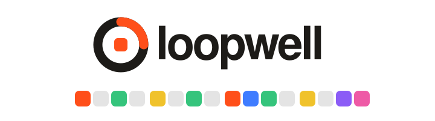
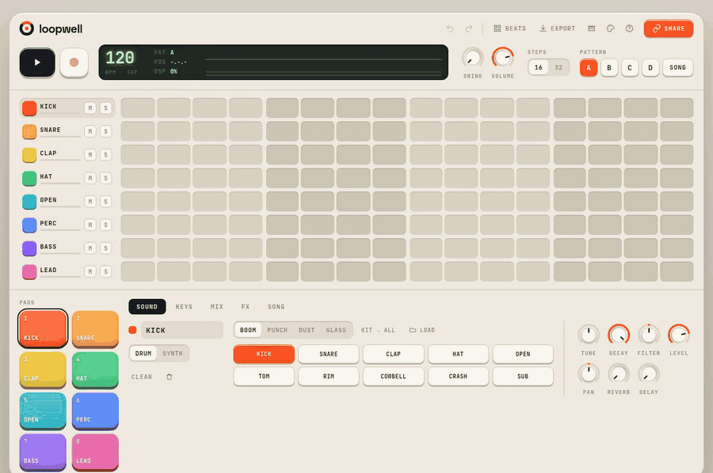
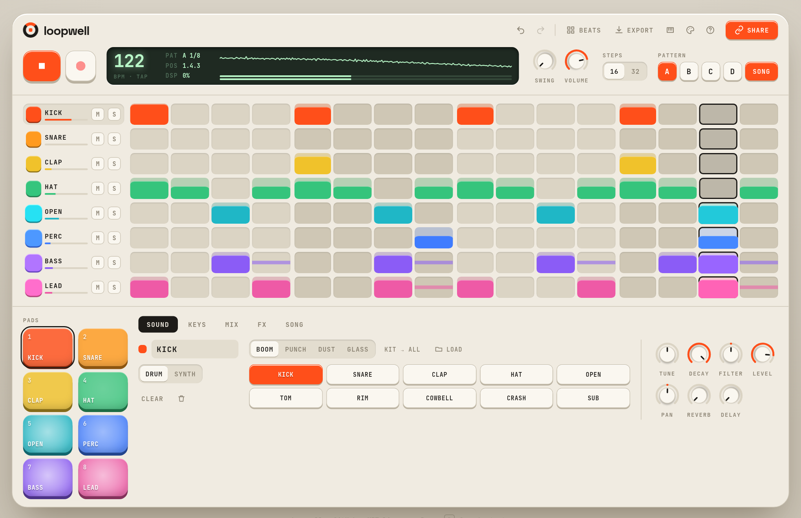
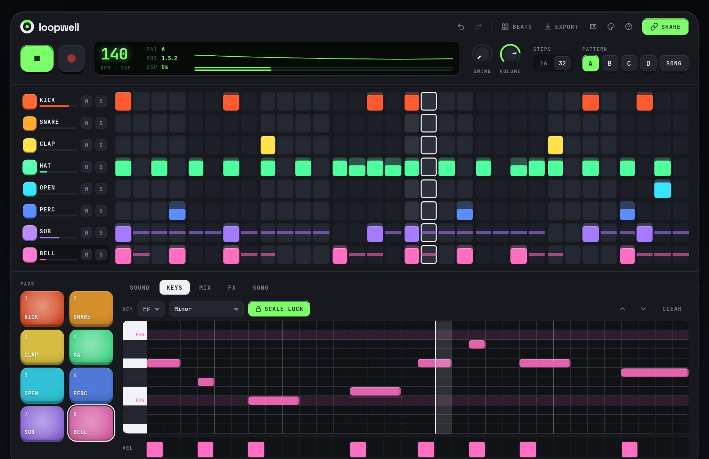
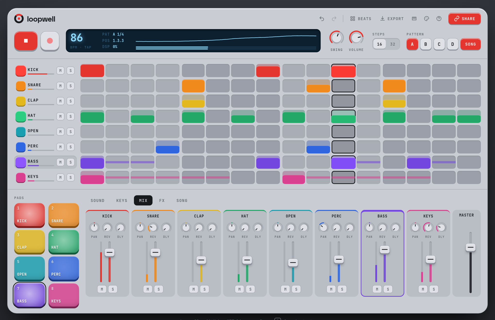
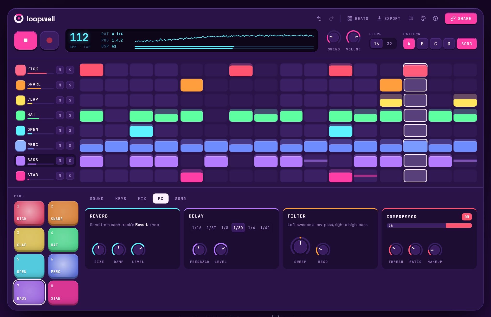
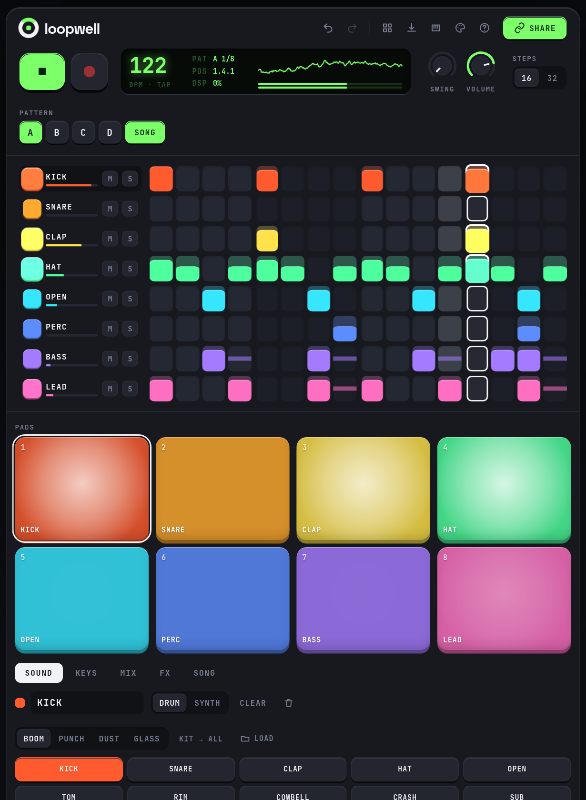

<div align="center">

<picture>
  <source media="(prefers-color-scheme: dark)" srcset="docs/banner-dark.svg">
  
</picture>

### A tactile beat maker that lives in your browser.

Make a beat in seconds. Share it with a link. No account, no install, no backend.

[](https://github.com/aubergine-ux/loopwell/actions/workflows/ci.yml)
[](https://github.com/aubergine-ux/loopwell/releases)
[](LICENSE)
[](https://github.com/aubergine-ux/loopwell/search?l=typescript)
[](#-install-it-as-an-app)

**[▶ Open Loopwell](https://aubergine-ux.github.io/loopwell/)**

<br>



</div>

<br>

## 🎧 Hear it first

Each of these is a complete beat packed into a URL. Click one and it plays.

| Beat | Style | Link |
| :-- | :-- | :-- |
| **Night Drive** | Four-on-the-floor house, 122 bpm | [▶ Play it](https://aubergine-ux.github.io/loopwell/#b=jU7BSsNAEJ1NtulisaTSQw7WNNBDkCIIgiaGsNskoDTEJSkeeh7RgicRD17iL_g9_Qk_wU9xNoh6ETrsW3jvMe8Nq2H4jqtkbcdreRSGYwF8eZ0twWsfpQQQvaZSdcG8Fg11eVYqbXXsBDz7Sq1sr02NNeU3uqi4d7swLOS6qLO-1yZSJnDKF6ppYH6WwvH4IOiiIl4WKmfpLIb5MIzKUl5UAoAxgjWoNvcPz9P8afNy1x-NSHpFRKBxXfq2W1Iwjn9enpP6RqksjnuWFaBD2CPssxkOLR8dYBHaLCFDomAFDpgkI8Hf8E-zjbhTwYRyJlTgU4FPOYd_C9R3QUaG7I7u5uPfXDMWiACFMJc6kQYnIUgtnHPCJSHVXw) |
| **Dust Loop** | Swung boom-bap, 86 bpm | [▶ Play it](https://aubergine-ux.github.io/loopwell/#b=bY5BS8MwGIa_plnNBkrx1FPpZqkVUdCTC6E01pSZjllWd7Dn3DdQL7uU_QX_m_9nX9cVdhjh4eXNl_B81iO_GhtR1ySsU_9FTBjQ4j0rAq8xaQrABtVCLtX4UH1waTaX5cRr8nbo2TP5eXMsAf0o1SL0GtG2mJZqmd16jY6xPdFXWVVEjHwQuR9t2hdTWqivinAWOnmcJDp9zn0KANbw7ff7J5iv1xt7hxfW1hj3uk2-dV1Mzlf_GIZ3h-MfYOQwoGBH5sKKzIjcmUsSGgZOosGRiEJmmjkcSRCJKL1zOoNx_zoF7x2rEwfgvr1j0DuG1v3R83DOM0UEkiKZ3gM) |
| **Glass Hours** | Half-time with a sliding sub, 140 bpm | [▶ Play it](https://aubergine-ux.github.io/loopwell/#b=LYtPS8NAEMVnsmtY_EfAIovUUMFDDiJtLajBwyZxbUNDXNrm0oO0MAcPomDQQy77Kf0o3t0tzvAGfvPeQ4KjLVGyZmqt4iTpCeDzspgPpX1VCkDsLetsoUfSkseIF1VmxjuagGSzbHUjbeqtAX82up5Ie-cp4UYviltp1YsyTyO2bHK2AQDzfhV_-8A9z3VVBaZ3DeP9h7weqtUG4WD6tm3bwezj67PFTOElduTHNQEQELuu-f1pcPckSt36-x9RIEBEmKZpCGFModNxcEGRiOmM9encSUBQEkNNIcvpkD1S5PgEKzplJfX5lP4A) |
| **Punch Card** | Electro-funk with an acid bass, 112 bpm | [▶ Play it](https://aubergine-ux.github.io/loopwell/#b=lY7PSsNAEIdnky3GKCVq0ZxKqaUspEEtHjSI7CakjW2IodlTT_6ZgycPgpde8go-hA_kC_RZ6mxQ8Vp2P2Z-O7vsx7LjdoxXN0v7cim7QnQc4PO7ZO75NUoJ4LSqQi3Sgyb2weNJrspDv87N0LczpY_8-taEHr8v06Lj15FJgpfpIjnx69ETpQseq6qCYaGh77bFg7lxzSutYph0xyC6AzkZybHmAMDc8v31-aWXPL6hrQZ0sEJEzzPNCj6oRNF6TQUx-tvcvNxszJDy_7ULTKBF2CzAFtUdNkTHErjHTnGf-jb1DmdSc5YQU2KmXUsSCTElZlp9_nig99WIIIIx2tIkJJOQTM7JJCSTgExCMhFkEpDJ2a9JSmRETr_HRNpYuFahvwE) |

<br>

## ✨ Features

| | |
| :-- | :-- |
| 🥁 **Step sequencer** | 16 or 32 steps, up to 8 tracks, per-step velocity, swing, and four patterns you can chain into a song |
| 🎛️ **Sounds** | Four built-in drum kits (40 CC0 samples), drag-and-drop your own audio, and a built-in synth with oscillator, filter and envelope |
| 🎹 **Piano roll** | Draw bass lines and melodies. Scale lock removes every out-of-key row, so wrong notes are hard to play |
| 🎚️ **Mixer and FX** | Volume, pan, mute and solo per track, plus reverb, tempo-synced delay, filter and a master compressor |
| 🔗 **Share links** | The whole beat is encoded into the URL (about 350 characters). Opening it loads and plays, nothing is uploaded |
| 💾 **Export** | Render to 24-bit WAV, export a stem per track, export MIDI, or save a project file that bundles your samples |
| 🎮 **Hardware** | Web MIDI pads and keyboards work as soon as they are plugged in, and the computer keyboard plays pads and notes |
| 📱 **Anywhere** | Installs as a PWA, works offline, and has big touch pads on tablets |
| 🎨 **Themes** | Cream, Night, Slate and Arcade |

<br>

## 🚀 Quick start

1. Open **[Loopwell](https://aubergine-ux.github.io/loopwell/)** and press <kbd>Space</kbd>.
2. Click steps in the grid to add hits. Drag a step up or down to change how hard it hits.
3. Pick **BASS**, open the **Keys** tab, and draw some notes.
4. Press **Share** and send the link to someone.

<details>
<summary><b>Keyboard shortcuts</b></summary>

<br>

| Key | Action |
| :-- | :-- |
| <kbd>Space</kbd> | Play / stop |
| <kbd>1</kbd> to <kbd>8</kbd> | Hit pads |
| <kbd>A</kbd> <kbd>S</kbd> <kbd>D</kbd> <kbd>F</kbd> <kbd>G</kbd> <kbd>H</kbd> <kbd>J</kbd> <kbd>K</kbd> <kbd>L</kbd> <kbd>;</kbd> <kbd>'</kbd> | Play the selected synth up its scale (on a drum track: pads 1 to 8) |
| <kbd>Z</kbd> / <kbd>X</kbd> | Keyboard octave down / up |
| <kbd>R</kbd> | Record what you play into the pattern |
| <kbd>T</kbd> | Tap tempo |
| <kbd>-</kbd> / <kbd>=</kbd> | Tempo down / up (hold <kbd>Shift</kbd> for steps of 10) |
| <kbd>↑</kbd> / <kbd>↓</kbd> | Select track |
| <kbd>←</kbd> / <kbd>→</kbd> | Previous / next pattern |
| <kbd>M</kbd> / <kbd>Shift</kbd>+<kbd>M</kbd> | Mute / solo the selected track |
| <kbd>[</kbd> / <kbd>]</kbd> | Previous / next panel |
| <kbd>Shift</kbd>+<kbd>Backspace</kbd> | Clear the selected track |
| <kbd>Ctrl</kbd>+<kbd>Z</kbd> / <kbd>Ctrl</kbd>+<kbd>Shift</kbd>+<kbd>Z</kbd> | Undo / redo |
| <kbd>Shift</kbd>+<kbd>C</kbd> | Change colour theme |
| <kbd>?</kbd> | Show the shortcut list |

</details>

<details>
<summary><b>Mouse and touch</b></summary>

<br>

| Gesture | What it does |
| :-- | :-- |
| Click a step | Turn it on or off |
| Drag a step up or down | Set its velocity |
| Drag along a row | Paint steps |
| Drag a knob | Turn it. <kbd>Shift</kbd> for fine control, double-click to reset |
| Tap a pad high or low | Hit harder or softer |
| Drop an audio file on a track | Use it as that track's sound |
| Piano roll | Click to add a note, drag to move or stretch it, click a note to remove it |

</details>

<details>
<summary><b>MIDI controllers</b></summary>

<br>

Click the MIDI button in the top bar once and allow access. After that, controllers connect by themselves.

| Input | Result |
| :-- | :-- |
| Pad controller (notes from C1, or anything on channel 10) | Hits pads 1 to 8 |
| Keyboard, with a synth track selected | Plays that synth, snapped to the scale when scale lock is on |
| CC 7 | Master volume |
| CC 1 (mod wheel) | Master filter |
| CC 74 | Cutoff of the selected synth |
| MIDI start / stop | Play / stop |

Turn on record and whatever you play is written into the pattern, quantised to the grid.

Web MIDI is available in Chrome, Edge, Opera and Firefox. Safari does not support it.

</details>

<details>
<summary><b>Sharing beats that use your own samples</b></summary>

<br>

A share link carries the pattern data, every setting, and references to the built-in samples. Audio files are far too big for a URL, so tracks that use samples you dropped in are silent for whoever opens the link, and the Share dialog tells you when that applies.

To send those beats, use **Export → Save project**. The `.loopwell` file bundles the project and the original sample files, and anyone can drop it onto Loopwell to open it.

</details>

<br>

## 📲 Install it as an app

Loopwell is a PWA. In Chrome or Edge, use the install button in the address bar. On iPad or iPhone, use **Share → Add to Home Screen**. Once it has loaded, it keeps working with no connection, drum kits included.

<br>

## 🎨 Themes

<table>
  <tr>
    <td></td>
    <td></td>
  </tr>
  <tr>
    <td align="center"><b>Cream</b></td>
    <td align="center"><b>Night</b>, with the piano roll</td>
  </tr>
  <tr>
    <td></td>
    <td></td>
  </tr>
  <tr>
    <td align="center"><b>Slate</b>, with the mixer</td>
    <td align="center"><b>Arcade</b>, with the effects</td>
  </tr>
</table>

<details>
<summary><b>On a tablet</b></summary>

<br>

<div align="center"></div>

</details>

<br>

## 🛠️ Run it locally

You need [Node.js](https://nodejs.org) 22 or newer.

```bash
git clone https://github.com/aubergine-ux/loopwell.git
cd loopwell
npm install
npm run dev
```

Then open the address it prints, usually <http://localhost:5173>.

| Command | What it does |
| :-- | :-- |
| `npm run dev` | Start the dev server with hot reload |
| `npm run build` | Build the static site into `dist/` |
| `npm run preview` | Serve the built site locally |
| `npm test` | Unit tests: sequencer timing, share links, MIDI, project files, WAV |
| `npm run check` | Type-check the TypeScript and Svelte code |
| `npm run bench` | Stress-test the audio engine and print its real-time headroom |
| `npm run test:e2e` | Build, then drive the real app in headless Chromium |
| `npm run test:realtime` | Play through the real AudioWorklet while freezing the main thread |
| `npm run kits` | Regenerate the built-in drum kits |

The two browser tests look for Chromium at `/usr/bin/chromium`. Point them somewhere else with `CHROMIUM=/path/to/chrome npm run test:e2e`.

The output of `npm run build` is a plain static site with relative paths, so it can be hosted from any folder on any static host.

<br>

## ⚙️ How it works

<details>
<summary><b>Timing</b></summary>

<br>

The sequencer does not run on timers. It lives inside an `AudioWorklet` and counts audio frames, so every step starts on an exact sample, and nothing the page does can make it late. Voices are rendered in segments that are split wherever a step lands inside a 128-frame block.

The grid position is kept as a floating-point frame count and only rounded when a step fires, so rounding never builds up into drift. Swing delays the off-beat sixteenths by up to half a step.

| Check | Measured |
| :-- | :-- |
| Drift after 20,000 steps, at six tempo and sample-rate combinations | Never more than half a frame |
| Real Chromium, main thread frozen 43 times for up to 398 ms each | All 161 steps on their exact frame, no underruns |
| Worst-case project (every step on, 12 synth voices, all effects), 99.9th percentile block | About 4% of the real-time budget |
| Frame rate while a 32-step beat plays | 60 fps on every panel, no frame over 20 ms |

The lights are driven the other way round: the audio thread reports each step with its frame number, and one `requestAnimationFrame` loop shows it when that frame reaches the speakers. Playback never triggers a framework re-render.

</details>

<details>
<summary><b>One engine for playing and exporting</b></summary>

<br>

The engine in [`src/core`](src/core) is plain TypeScript with no browser APIs: sequencer, sample and synth voices, mixer, reverb, delay, filter and compressor. The worklet runs it in real time. WAV and stem export run the same class offline, faster than real time, so an export sounds like what you heard. The unit tests run it in Node and check the rendered audio sample by sample.

</details>

<details>
<summary><b>Share links</b></summary>

<br>

A beat is written into a compact binary layout, compressed with DEFLATE, and base64url-encoded into the URL fragment. The fragment never leaves the browser, so beats are not sent to any server.

- Every knob is a small integer, so a beat survives the round trip exactly.
- A drum row is a 32-bit mask. Velocities are only stored when they differ from the default.
- A built-in sample is a single byte.
- Empty patterns cost nothing.

A typical beat is 300 to 400 characters and a completely full project stays under 2,000. Damaged or unknown links are rejected with a message instead of loading garbage.

</details>

<details>
<summary><b>The drum kits</b></summary>

<br>

The four kits are not recordings. [`scripts/build-kits.ts`](scripts/build-kits.ts) synthesises all 40 sounds from oscillators and noise, and the results are dedicated to the public domain under [CC0](public/kits/LICENSE.txt). Run `npm run kits` to regenerate them, or edit the script to design your own.

</details>

<details>
<summary><b>Project layout</b></summary>

<br>

```text
src/
  core/        engine, clock, DSP, share-link codec, MIDI, WAV, project files, demo beats
  audio/       AudioWorklet wrapper, main-thread host, Web MIDI input
  ui/          Svelte components
  actions.svelte.ts   everything the interface can do to a beat
scripts/       drum kit synthesis, benchmark, browser checks, README assets
tests/         unit tests, end-to-end test, real-time timing check
public/kits/   the generated drum samples
```

</details>

<details>
<summary><b>Browser support</b></summary>

<br>

| Browser | Status |
| :-- | :-- |
| Chrome, Edge, Opera | Everything. The automated tests run in Chromium on every commit |
| Firefox | Uses only APIs Firefox supports, but is not covered by the automated tests |
| Safari (macOS, iPadOS, iOS) | Same, minus MIDI controllers, which Safari does not support |

Browsers only allow sound after a click or tap. If you open a share link in a browser that has never seen the site, you get one big play button first.

</details>

<br>

## 🧱 Built with

[TypeScript](https://www.typescriptlang.org) · [Svelte 5](https://svelte.dev) · [Vite](https://vite.dev) · Web Audio `AudioWorklet` · Web MIDI · [fflate](https://github.com/101arrowz/fflate) · [Vitest](https://vitest.dev) · [Playwright](https://playwright.dev)

Typefaces: [Space Grotesk](https://github.com/floriankarsten/space-grotesk) and [JetBrains Mono](https://www.jetbrains.com/lp/mono/), both under the SIL Open Font License.

<br>

---

<div align="center">

Released under the [MIT License](LICENSE). Drum samples are [CC0](public/kits/LICENSE.txt).

Made by [@aubergine-ux](https://github.com/aubergine-ux)

</div>
